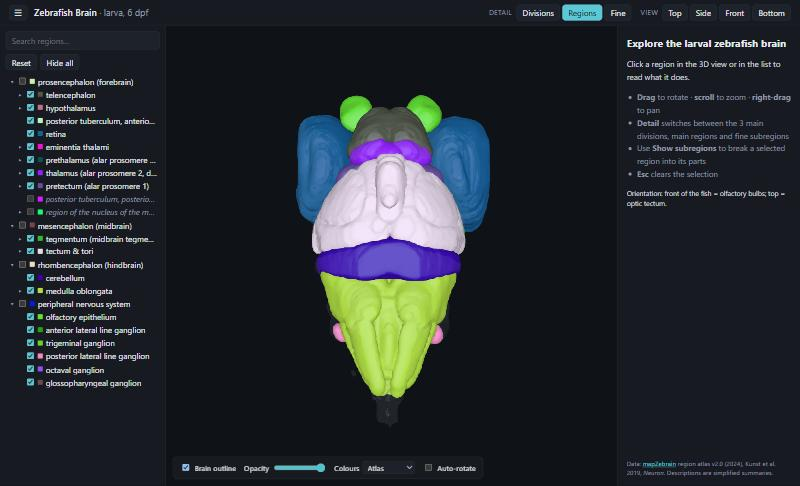

# Zebrafish Brain Viewer

An interactive 3D viewer of the larval zebrafish brain (6 days post-fertilization). It shows the 112 annotated regions of the mapZebrain atlas, and you can click any region to read what it does.

**Open it: [yclen.github.io/zebrafish-brain-viewer](https://yclen.github.io/zebrafish-brain-viewer/)**. It runs in your browser, with nothing to install.

## Running it locally

Double-click **`Start Viewer.bat`**. It starts a small local web server and opens http://localhost:8765/ in your browser. Close the black console window to stop the server.

(Opening `index.html` directly does not work, because browsers block loading the 3D file from `file://`.)

The page needs an internet connection the first time, to load Three.js from the jsDelivr CDN.

## What you can do

- **Detail:** switch between the three main divisions, the main regions, and the fine subregions (73 visible at once).
- **Click** a region (in 3D or in the list) to see its description, its place in the hierarchy and its subregions.
  - **Show subregions** breaks the selected region into its parts.
  - **Show parent** merges it back.
  - **Show only this** fades out everything else.
- **View:** Top / Side / Front / Bottom camera presets. Drag to rotate, scroll to zoom, right-drag to pan.
- **Search** matches region names and descriptions (e.g. "raphe", "escape", "prey").
- **Colours:** use the original atlas colours, or colour by division (forebrain / midbrain / hindbrain / peripheral).
- **Slice:** cut the model top → bottom, front → back or side → side, then drag the slider to move through it. Cut regions show as solid coloured cross-sections, and a readout shows the depth in µm. The ⇅ button keeps the other half.
- **Fish body:** shows a see-through body surface and swim bladder from a real micro-CT scan, with the brain sitting inside it.

## Files

| Path | What it is |
|---|---|
| `index.html`, `app.js`, `style.css` | The viewer (Three.js 0.170, no build step) |
| `data/brain.glb` | All 110 region meshes plus the brain outline, simplified and compressed (about 4 MB, 608k triangles) |
| `data/fish.glb` | Fish body and swim bladder in atlas coordinates (0.3 MB) |
| `data/regions.json` | Region hierarchy, atlas colours and plain-language function summaries |
| `build/` | Scripts that regenerate the data from mapZebrain |

## Data source and caveats

- The meshes and hierarchy come from [mapZebrain](https://mapzebrain.org) (Max Planck Institute for Biological Intelligence), region annotation **v2.0 (MECE, 2024)**. They are redistributed here in simplified form, with credit. Please cite Kunst et al. 2019, *A Cellular-Resolution Atlas of the Larval Zebrafish Brain*, Neuron 103:21–38. The MIT license in this repository covers the viewer code only, not the atlas data.
- **The fish body** comes from a micro-CT scan of a 5-day-old larva (fish 3, file `5dpf_3_axial_8bit_chenglab.tif`) from Ding et al. 2019, *eLife* 8:e44898, published on [Dryad](https://doi.org/10.5061/dryad.4nb12g2) under CC0.
  - The scan covers only the head and front trunk, about 1.5 mm from the snout, so the body ends flat there; a whole larva is about 3.9 mm long.
  - It was lined up with the atlas by matching its eye lenses to the atlas eyes (which set the position and a scale of 1.09) and its brain outline to the atlas brain (which set the head tilt). The brains of the two fish match to within about 16 µm.
  - The fit is approximate: the scan and the atlas come from different fish, one day apart in age.
  - The swim bladder is the largest air pocket inside the scanned body.
  - `build/ct_fish_body.py` holds the processing script.
- Three regions have no 3D mesh in the atlas, so they appear in grey italics in the list:
  - posterior tuberculum, posterior part
  - region of the nucleus of the medial longitudinal fascicle
  - nucleus of the medial longitudinal fascicle
- The original STL files are mostly wound inside-out, and the build script corrects this. Coordinates are in µm. The atlas axes are:
  - x = left-right
  - y = anterior → posterior
  - z = ventral → dorsal
- Left and right are not labelled, because the atlas files do not say which side is which.
- The function descriptions in `build/make_regions_json.py` are simplified summaries written for learning. Larval zebrafish circuit roles are still being mapped, so check the primary literature before relying on a specific claim.

## Rebuilding the data

You only need to do this to change the mesh quality or to pick up a new atlas version.

1. Fetch the hierarchy from the mapZebrain API (`POST https://api.mapzebrain.org/api/load_region_data_by_version/` with body `{"regionVersion": "2.0 (MECE, 2024)"}`) and save it as `regions_raw.json`.
2. Run `python -I build/list_meshes.py regions_raw.json items.json` to list the mesh URLs and sizes.
3. Run `python -I build/download_meshes.py items.json stl/` to download about 270 MB of ASCII STL.
4. Install the build tools in a scratch folder (not inside the vault): `npm i @gltf-transform/core@4 @gltf-transform/functions@4 @gltf-transform/extensions@4 meshoptimizer`.
5. Run `TOOLS_DIR=<that folder> node build/build_glb.mjs items.json stl/ data/brain.glb 0.3 0.001`. The last two numbers are the simplification ratio and the error tolerance; higher values give a smaller, coarser mesh.
6. Run `python -I build/make_regions_json.py items.json data/regions.json`.
7. For the fish body:
   1. From the Dryad dataset, extract `5dpf_3_axial_8bit_chenglab.tif` and `brain_region_segmentations/5dpf_3_Registered_Seg.tif`. Dryad blocks automated downloads, so download the two `.7z` archives in a browser.
   2. Install the Python packages: `pip install py7zr scikit-image tifffile`.
   3. Run `python -P build/ct_fish_body.py <recon.tif> <seg.tif> items.json stl/ ct-out/ 8`.
   4. Run `build_glb.mjs` on `ct-out/` with an items file listing `fish_body` and `swim_bladder`.
